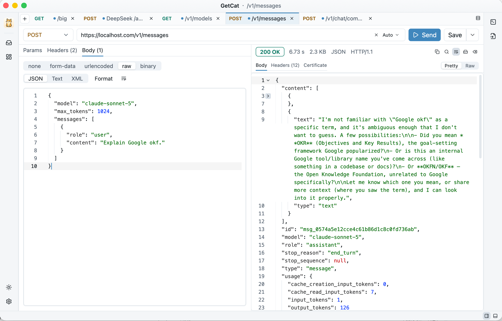

<div align="right">
<a href="README.md">English</a> · <a href="README.zh-CN.md">简体中文</a> · <b>繁體中文</b> · <a href="README.ja.md">日本語</a> · <a href="README.fr.md">Français</a>
</div>

<div align="center">


# GetCat

**以 Rust + [GPUI](https://gpui.rs) 打造的原生跨平台 HTTP API 除錯工具**

No Postman, Just GetCat!

GPU 繪製 · 低資源占用 · 免帳號 · 資料全在本機 · No Electron, No Tauri, No WebView

[](LICENSE)
[](https://www.rust-lang.org)
[](https://gpui.rs)
[](https://github.com/finch-xu/GetCat/releases)
[](https://github.com/finch-xu/GetCat/releases)
[](https://github.com/finch-xu/GetCat/releases)

[DeepWiki 文件](https://deepwiki.com/finch-xu/GetCat) · [官方網站](https://getcat.io/)



</div>

## 特色

- **原生且輕快**：GPU 繪製的原生視窗，不是 Electron / Tauri / WebView；macOS、Linux、Windows 三平台同一套介面。
- **大型回應不卡頓**：串流接收、即時進度、隨時取消；≤ 5 MB 用語法高亮編輯器，≤ 64 MB 按行虛擬化（照樣能拖曳選取、⌘C 複製），更大的寫入磁碟後預覽並可一鍵儲存，上百 MB 的回應也不會拖慢介面。回應主體與回應標頭都能一鍵複製。
- **完整的請求建構**：GET / POST / PUT / PATCH / DELETE / HEAD / OPTIONS；Path 參數（URL 中的 `{name}`）、Query、Headers；Body 支援 form-data（文字 / 檔案欄位，檔案以固定長度串流上傳）、x-www-form-urlencoded、raw JSON / Text / XML、binary 整個檔案上傳。
- **大型語言模型串流除錯**：SSE（text/event-stream）回應邊收邊顯示，不必等串流結束；自動辨識 OpenAI Chat Completions / Responses 與 Anthropic Messages 的串流格式，提供事件串流 / 組合文字 / 原始三種檢視，並附 TTFT、事件數、token 用量與生成速率統計。側欄內建三家 API 的請求範本（純文字 / 含圖片 / 串流），以及 MCP 兩個協定世代的範本。
- **指令進出自如**：右側欄可把目前的請求轉成 cURL / Python 範例，也能反過來貼上一條 curl 指令匯入——瀏覽器「複製為 cURL」的輸出可直接使用，沒能匯入的選項會如實列出。
- **變數與前後置操作**：全域 / 分類 / 環境三層變數，支援 `{{var}}` 與 `{{$timestamp}}` 替換；傳送前設定變數、回應後擷取欄位到變數並做斷言，不用寫指令碼；可匯入匯出 Postman environment；敏感變數在介面上以遮罩顯示。
- **資料屬於你**：不存歷史、不存回應、不上傳任何東西。已儲存的請求、草稿、設定都是排版過的 JSON 檔案，可手動編輯、可用 Git 管理。
- **主題與語言跟隨系統**，也可固定為淺色 / 深色、English / 简体中文 / 繁體中文 / 日本語 / Français；自繪標題列，三平台外觀一致。
- **無障礙**：所有控制項都有無障礙名稱，可搭配螢幕閱讀器使用。

## 安裝

從 [GitHub Releases](https://github.com/finch-xu/GetCat/releases) 下載對應平台的安裝檔

<table>
  <thead>
    <tr><th>平台</th><th>檔案</th><th>下載</th><th>說明</th></tr>
  </thead>
  <tbody>
    <tr><td>macOS（Apple Silicon）</td><td><code>GetCat-macos-arm64.dmg</code></td><td><a href="https://github.com/finch-xu/GetCat/releases/latest/download/GetCat-macos-arm64.dmg">全球下載</a> · <a href="https://d.mirror.catonthe.top/GetCat/GetCat-macos-arm64.dmg">中國下載</a></td><td rowspan="2">已簽署並經過公證，拖進「應用程式」即可</td></tr>
    <tr><td>macOS（Intel）</td><td><code>GetCat-macos-x64.dmg</code></td><td><a href="https://github.com/finch-xu/GetCat/releases/latest/download/GetCat-macos-x64.dmg">全球下載</a> · <a href="https://d.mirror.catonthe.top/GetCat/GetCat-macos-x64.dmg">中國下載</a></td></tr>
    <tr><td>Linux（x64）</td><td><code>GetCat-linux-x64.tar.gz</code></td><td><a href="https://github.com/finch-xu/GetCat/releases/latest/download/GetCat-linux-x64.tar.gz">全球下載</a> · <a href="https://d.mirror.catonthe.top/GetCat/GetCat-linux-x64.tar.gz">中國下載</a></td><td rowspan="2">解壓縮後得到 <code>getcat</code>，系統需求見下方</td></tr>
    <tr><td>Linux（arm64）</td><td><code>GetCat-linux-arm64.tar.gz</code></td><td><a href="https://github.com/finch-xu/GetCat/releases/latest/download/GetCat-linux-arm64.tar.gz">全球下載</a> · <a href="https://d.mirror.catonthe.top/GetCat/GetCat-linux-arm64.tar.gz">中國下載</a></td></tr>
    <tr><td>Windows（免安裝版，x64） <strong>推薦</strong></td><td><code>GetCat-windows-x64.exe</code></td><td><a href="https://github.com/finch-xu/GetCat/releases/latest/download/GetCat-windows-x64.exe">全球下載</a> · <a href="https://d.mirror.catonthe.top/GetCat/GetCat-windows-x64.exe">中國下載</a></td><td rowspan="2">單一檔案，放在哪裡都能執行，系統需求見下方</td></tr>
    <tr><td>Windows（免安裝版，arm64） <strong>推薦</strong></td><td><code>GetCat-windows-arm64.exe</code></td><td><a href="https://github.com/finch-xu/GetCat/releases/latest/download/GetCat-windows-arm64.exe">全球下載</a> · <a href="https://d.mirror.catonthe.top/GetCat/GetCat-windows-arm64.exe">中國下載</a></td></tr>
    <tr><td>Windows（安裝版，x64）</td><td><code>GetCat-windows-x64.msi</code></td><td><a href="https://github.com/finch-xu/GetCat/releases/latest/download/GetCat-windows-x64.msi">全球下載</a> · <a href="https://d.mirror.catonthe.top/GetCat/GetCat-windows-x64.msi">中國下載</a></td><td rowspan="2">安裝到目前使用者的目錄，不需要系統管理員權限；可從開始功能表啟動</td></tr>
    <tr><td>Windows（安裝版，arm64）</td><td><code>GetCat-windows-arm64.msi</code></td><td><a href="https://github.com/finch-xu/GetCat/releases/latest/download/GetCat-windows-arm64.msi">全球下載</a> · <a href="https://d.mirror.catonthe.top/GetCat/GetCat-windows-arm64.msi">中國下載</a></td></tr>
  </tbody>
</table>

<details>
<summary>相容的 Linux 系統版本</summary>

支援 2022 年以後的主流桌面發行版：**Ubuntu 22.04+**、**Debian 12+**、**Fedora 36+**、**Linux Mint 21+**、**openSUSE Leap 15.6+**，以及 Arch、openSUSE Tumbleweed 等滾動發行版。這些系統的圖形驅動程式開箱即用，不需要額外安裝。

更舊的發行版無法執行：Ubuntu 20.04、Debian 11，以及 RHEL / Rocky / AlmaLinux 9 —— 最低需求是 glibc 2.35，它們都低於這個版本。

解壓縮後直接執行 `./getcat` 即可。想讓它出現在應用程式列表（Ubuntu 的「顯示應用程式」）與 Dock 裡，請開啟 **設定 → 一般 → 加入應用程式選單**：GetCat 會把啟動項目與圖示寫到 `~/.local/share` 下，之後按 Super 鍵搜尋 GetCat 就能啟動，按右鍵還能「加入喜好」釘選在 Dock 上；關閉開關即刪除。在 Wayland 下，視窗與 Dock 的圖示也來自這份啟動項目，所以沒開啟開關時工作列裡顯示的是通用圖示。

啟動項目指向目前的執行檔，建議先把 `getcat` 放到固定位置再開啟開關，例如：

```bash
tar -xzf GetCat-linux-x64.tar.gz
install -Dm755 getcat ~/.local/bin/getcat
~/.local/bin/getcat
```

移動過檔案的話，把開關關閉再開啟一次，路徑就會更新。

</details>

<details>
<summary>Linux 版啟動後黑畫面，或出現 Vulkan / 找不到 GPU 的錯誤</summary>

介面由 GPU 透過 Vulkan 繪製。桌面發行版通常內建驅動程式，請先自我檢查：

```bash
vulkaninfo --summary
```

沒有輸出、或提示找不到裝置時，請依顯示卡安裝驅動程式：

| 環境 | 指令 |
|---|---|
| Ubuntu / Debian + Intel、AMD 顯示卡 | `sudo apt install mesa-vulkan-drivers` |
| Fedora + Intel、AMD 顯示卡 | `sudo dnf install mesa-vulkan-drivers` |
| Arch + Intel、AMD 顯示卡 | `sudo pacman -S vulkan-intel` 或 `vulkan-radeon` |
| NVIDIA 顯示卡 | 安裝原廠專有驅動程式（如 `nvidia-driver-550`）；開源的 nouveau 不提供 Vulkan |
| 虛擬機器 / 無獨立顯示卡 | 安裝 `mesa-vulkan-drivers`，會退回 lavapipe 軟體繪製，能用但較慢 |

</details>

<details>
<summary>相容的 Windows 系統版本</summary>

需要 **Windows 10 1803（2018 年 4 月更新）以上**，或 Windows 11。介面透過 Direct3D 11 繪製，2010 年前後的顯示卡就足夠（feature level 10.1 起），不需要 DirectX 12。

兩個版本都能用，推薦免安裝版（ARM 裝置，如 Snapdragon 筆電，請選 `-arm64` 結尾的檔案）：

- **`GetCat-windows-<arch>.exe`（免安裝版，推薦）**：單一檔案，放在隨身碟或任意目錄直接按兩下執行，不寫入登錄檔。
- **`GetCat-windows-<arch>.msi`（安裝版）**：安裝到 `%LOCALAPPDATA%\Programs\GetCat`，不需要系統管理員權限，開始功能表裡會出現 GetCat，也能從「應用程式與功能」解除安裝。

兩者都支援應用程式內的自動更新：裝了 MSI 的會下載新的 MSI 靜默升級，免安裝版則直接替換 exe。

兩者目前都還沒有程式碼簽章，第一次執行時 SmartScreen 會攔下：免安裝版 exe 請按「其他資訊」→「仍要執行」；MSI 是安裝檔，攔截得更明顯，同樣從「其他資訊」進去放行。

</details>

## 使用方式

1. 選擇方法、輸入 URL，按 **⌘ Enter**（Windows / Linux 為 Ctrl Enter）傳送。
2. 在 Params / Headers / Body 頁籤填寫參數；URL 裡的 `{name}` 會自動出現在 Path 參數表中。
3. 在回應區檢視狀態 / 耗時 / 大小，切換 Pretty / Raw，按 **⌘ F** 在回應內搜尋，或儲存到檔案。
4. 按 **⌘ S** 把請求儲存到側欄，之後點開即可使用。已儲存的請求支援單層分類：儲存時選擇或新增分類，側欄會按分類瀏覽。

| 操作 | macOS | Windows / Linux |
|---|---|---|
| 傳送 | ⌘ Enter | Ctrl Enter |
| 新 Tab / 關閉 Tab | ⌘ T / ⌘ W | Ctrl T / Ctrl W |
| 收合側欄 | ⌘ B | Ctrl B |
| 儲存請求 | ⌘ S | Ctrl S |
| 在回應內搜尋 | ⌘ F | Ctrl F |
| 設定 | ⌘ , | Ctrl , |

設定裡可以調整介面語言（跟隨系統 / English / 简体中文 / 繁體中文 / 日本語 / Français）、請求逾時、重新導向、TLS 驗證、編輯器字級，以及是否在啟動時檢查更新。

### 資料目錄

| 平台 | 目錄 |
|---|---|
| macOS | `~/Library/Application Support/GetCat/` |
| Linux | `$XDG_DATA_HOME/getcat/`（預設為 `~/.local/share/getcat/`） |
| Windows | `%APPDATA%\GetCat\data\` |

```
workspace.json          # Tab 順序、側欄、分欄方向、主題偏好
requests/<ulid>.json    # 每個已儲存的請求一個檔案
drafts/<tab-id>.json    # 每個 Tab 一份草稿
settings.json           # 應用程式設定
```

寫入是不可分割的（暫存檔 → 取代），當機也不會留下寫到一半的檔案；解析失敗的檔案會被改名為 `.corrupt-<時間>` 並略過。Header 裡的 `Authorization` 等以明文儲存（與 Postman / Insomnia 的本機資料庫一致），在 Unix 上檔案權限為 0600。

## 二次開發

### 架構

```
crates/
├─ getcat-core   # 不含 UI 的核心：請求模型、傳送（reqwest + tokio）、大型回應分級與寫入磁碟、JSON 檔案儲存
└─ getcat-app    # GPUI 介面：Workspace / RequestTab 狀態、設定對話框、應用程式內更新
```

- UI 框架是 Zed 的 [gpui](https://github.com/zed-industries/zed/tree/main/crates/gpui) + [GPUI Kit](https://github.com/longbridge/gpui-kit)（gpui-component 元件庫），依照 Kit 0.6 官方的方式只依賴 crates.io 上的 `gpui-kit` 一個套件，由它鎖定配套的 gpui 版本。
- 網路在 tokio 執行環境中執行，結果透過 channel 回到 GPUI 主執行緒；背景處理（排版 / 建立索引）以 `catch_unwind` 包住，panic 只會顯示為「背景處理異常」。
- 持久化不使用資料庫：`getcat-core/src/store` 負責讀寫，寫入走獨立執行緒並以 500 ms 合併。

### 建置與除錯

- Rust ≥ 1.97（edition 2024）。macOS 不需要額外的工具鏈；Linux 需要 Vulkan 與 Wayland / X11 / fontconfig 標頭檔（清單見 `.github/workflows/ci.yml`）；Windows 需要 MSVC 工具鏈，Direct3D 11 已包含在 Windows SDK 中。
- 應用程式 logo：`crates/getcat-app/assets/logo/getcat-art.svg`（完整版）與 `getcat-art-mini.svg`（≤ 32 px 用的簡化版）是原圖，`scripts/gen-logo.py` 會把它們合成為淺 / 深兩套配色的產物 —— app 內嵌的 `getcat.png` 與 `getcat-mini.png`（淺色，另有 `-dark` 深色版，app 依主題切換）、macOS 圖示來源 `resources/macos/getcat-1024.png`、Windows exe 圖示 `resources/windows/getcat.ico`；修改 logo 後請手動重新執行指令碼並提交產物（CI 不會產生，需要 `pip install pillow numpy`，SVG 點陣化由 `tools/svg-raster` 完成）。
- Windows 的 exe 圖示與版本資訊由 `crates/getcat-app/build.rs` 嵌入，只在 Windows 上原生編譯時生效（從 macOS 交叉編譯出的 exe 沒有圖示）。安裝檔定義在 `crates/getcat-app/resources/windows/GetCat.wxs`，需要 WiX v6：`dotnet tool install --global wix --version 6.*`。

```bash
cargo run -p getcat-app                         # 執行
cargo test --workspace                          # 單元 + wiremock + gpui TestAppContext 測試
RUST_LOG=debug cargo run -p getcat-app          # 調整日誌層級
cargo run -p getcat-app --features inspector    # 元素檢查器：⌘⌥I / Ctrl+Shift+I 檢視 id / role
GETCAT_UPDATE_CHECK=1 cargo run -p getcat-app   # 開發版本也在啟動時檢查更新（只檢查不安裝）
```

本機測試介面：`tools/testserver/server.py` 是一個零依賴（只用 Python 標準函式庫）的小型 server，專門提供難搞的介面 —— 慢回應、超大回應主體（1 / 5 / 10 / 20 / 50 MB）、chunked 涓流、大型語言模型 SSE 串流（OpenAI / Anthropic 兩種事件格式，含 usage）、最小 MCP 端點、任意狀態碼、中途斷線、大量超長回應標頭，用來手動驗證大型回應分級、串流進度與取消。啟動後開啟首頁就是附參數說明的介面清單，每個範例都能一鍵複製完整 URL 貼到 GetCat。

```bash
python3 tools/testserver/server.py                             # 127.0.0.1:8765，首頁即介面清單
python3 tools/testserver/server.py --port 9000 --host 0.0.0.0  # 換連接埠 / 讓同網段的裝置也能存取
```

提交前：`cargo fmt --all`、`cargo clippy --workspace --all-targets -- -D warnings`、`cargo test --workspace`。CI 會在三個平台上執行建置與測試，並用 cargo-deny 攔截 copyleft 依賴。

## 授權條款

[Apache-2.0](LICENSE)。第三方依賴清單見 [THIRD-PARTY.md](THIRD-PARTY.md)。
